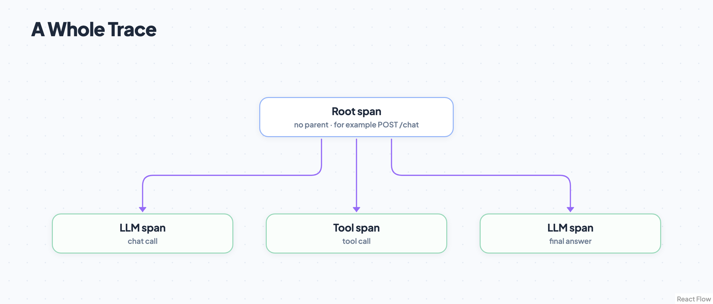

![Two routes from your app to Agent Observability. On the left are the two ways to send traces: the Splunk AO Python SDK and your own OpenTelemetry setup, both over OTLP. On SaaS, both send to Splunk Observability Cloud at your realm's ingest endpoint, path /v2/trace/otlp. Splunk Observability Cloud sends all spans to Splunk APM. It sends only AI spans to Agent Observability (SaaS), and drops the non-AI spans. On a self-hosted deployment, both send straight to Agent Observability (self-hosted) at the API URL of your deployment.](/images/concepts/logging/how-data-reaches-ao/ao-data-routes.png)

## What a whole trace looks like

A trace is a tree of spans. The root span is the span with no parent. With its root, a trace appears in the Traces list and in trace counts, and trace-level evaluators run on it.

## Find your route

The Splunk AO Python SDK (`splunk-ao`) exports OpenTelemetry (OTLP) traces. Your own OpenTelemetry setup uses the same endpoint as the SDK.

- **Self-hosted.** Send OTLP traces to `<api-url>/otel/v1/traces`. Replace `<api-url>` with the API URL of your deployment, for example `https://api.<domain>`.
- **SaaS.** Send OTLP traces to `https://ingest.<realm>.observability.splunkcloud.com/v2/trace/otlp`. Replace `<realm>` with your Splunk Observability Cloud realm, for example `us0`.

## Self-hosted

Your deployment stores each valid span you send, whether or not it is an AI span. It reads prompts and responses from span events and from span attributes. The trace appears in the Traces list when its root span arrives, in the same request or a later one.

Evaluators expect a complete, unbroken trace. These traces are not evaluated, and their metrics show [code 2019](https://docs.galileo.ai/references/faqs/errors-catalog):

- A trace without its root span. Its spans are stored, but the trace is not listed.
- A trace with a gap: a span whose parent never arrives. The trace is evaluated if the missing span arrives later.
- A trace with a span under an LLM or control span. A control span records an Agent Control action.

A session with more than 1,000 traces, or with more than 512 MiB of records, is not evaluated. Its session metrics show [code 2040](https://docs.galileo.ai/references/faqs/errors-catalog). Trace and span metrics in that session are still evaluated.

## Splunk Agent Observability (SaaS)

On SaaS, traces enter through Splunk Observability Cloud. It sends all spans to Splunk APM. It sends only the spans that look like AI spans to Agent Observability, and drops the rest. For how this hand-off affects delivery and timing, see [SaaS Ingestion Behavior](https://agent-observability-docs.splunk.com/saas/ingestion-behavior).

### Which spans are kept

A span is kept when the span, or the service that sent it, carries one of these attributes:

- `gen_ai.operation.name`
- `mcp.method.name`
- `splunk_ao.project.name`
- `splunk_ao.logstream.name`

A trace reaches Agent Observability only when at least one of its spans carries `gen_ai.operation.name` or `mcp.method.name` on the span itself. A kept trace can lose its plain spans, often its root. When the root is dropped, Agent Observability adds a stand-in root:

Tagging the service with the project name keeps more of its spans. It does not keep every span, and it does not guarantee that the root is kept.

### The Splunk AO Python SDK

The SDK sets `gen_ai.operation.name` on the LLM, tool, retriever, workflow, agent and control spans it records. A trace with at least one of those spans normally arrives whole.

### Your own OpenTelemetry setup

The root of your trace is often a plain web request. Splunk Observability Cloud drops it, so the trace gets a stand-in root that carries none of your root span's data.

Spans that carry only OpenInference attributes are not kept. Turn on the `gen_ai.*` attributes. See [the OpenInference guidance](https://agent-observability-docs.splunk.com/sdk-api/third-party-integrations/opentelemetry-and-openinference/integration-recommendations) and the [OpenTelemetry integration page](https://agent-observability-docs.splunk.com/how-to-guides/third-party-integrations/otel).

### How incomplete traces are handled

- **No root span.** A stand-in root is added about 10 minutes after the trace goes quiet. The trace then appears in the Traces list and is evaluated.
- **A gap in the middle.** A span's parent never arrives. The trace is evaluated.
- **A span under an LLM or control span.** The trace is evaluated. That span and the spans under it are not applicable ([code 2033](https://agent-observability-docs.splunk.com/references/faqs/errors-catalog)).
- **Too large to evaluate.** A trace with more than 1,000 spans is not evaluated ([code 2036](https://agent-observability-docs.splunk.com/references/faqs/errors-catalog)).
- **Too large a session.** A session with more than 1,000 traces, or with more than 512 MiB of records, is not evaluated ([code 2040](https://agent-observability-docs.splunk.com/references/faqs/errors-catalog)). Its traces and spans are still evaluated.
- **A late span.** The whole trace is evaluated again.

Evaluation of an incomplete trace is best effort. A trace with a stand-in root shows a blank input and output. Evaluators that read only the trace's input and output take the input from the first direct child span that has one. They take the output from the last direct child span that has one. Your app never sent that pair together. The stand-in takes the earliest span's start time, so counts for a recent period can rise later.

For how traces assemble when spans arrive late or out of order, see [Distributed Tracing Concepts](https://agent-observability-docs.splunk.com/concepts/logging/distributed-tracing-behavior).
